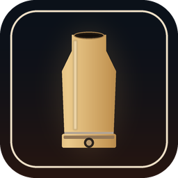

# SPT Quick Start

One-click starter for a [Single Player Tarkov](https://www.sp-tarkov.com/) install:
it starts the SPT server, waits until the server actually answers, and then launches
the game client with the profile you used last — no launcher, no dropdown, no second click.



## What it does

1. **Server check** — if `https://127.0.0.1:6969/launcher/v2/ping` already answers, the
   running server is reused. If port 6969 is merely occupied, the tool waits instead of
   starting a second server. Otherwise `SPT.Server.exe` is started.
2. **Wait for readiness** — the tool polls the launcher ping endpoint until it returns
   `200 OK` (240 s timeout, aborts early if the server process dies). No guesswork with
   fixed sleeps.
3. **Resolve the profile** — reads `SPT_Runtime\user\Launcher\LauncherSettings.json` and
   takes `PreferredProfile.ProfileId`, i.e. exactly the profile the SPT launcher used
   last. Falls back to the only profile present; refuses to guess when there are several.
4. **Launch the client** — replicates what the launcher does before starting the game
   (file cleanup honouring `ExcludeFromCleanup`) and then starts `EscapeFromTarkov.exe`
   with the launcher's own argument format:

   ```
   -force-gfx-jobs native -token=<profileId>
   -config={'BackendUrl':'https://127.0.0.1:6969','Version':'live','MatchingVersion':'live'}
   ```

5. **Shutdown** — the launcher now waits for the game in the background (its console window
   hides while you play) and stops the server it started as soon as `EscapeFromTarkov.exe`
   exits. The client's logout/profile save gets a few seconds to land first, so nothing is
   cut off mid-write. A server that was already running before the tool was started is never
   touched.

Everything is appended to `SPT-Start.log` next to the exe, so a failed start can be
diagnosed afterwards.

## Requirements

- Windows 10/11, x64
- .NET Framework 4.x (part of Windows — nothing to install)
- An SPT 4.x installation (the folder that contains `SPT_Runtime` and `EscapeFromTarkov.exe`)

## Install

1. Build or download `SPT-Start.exe` and put it in the SPT install root, next to
   `EscapeFromTarkov.exe`.
2. Double-click. That's it.

The exe locates everything relative to its own directory, so the same file works in
any SPT install (main install, ISB/Aishi, Storyline Backport, ...).

## Command line options

| Option | Effect |
|---|---|
| `--profile <id>` | force a specific profile id instead of the last used one |
| `--launcher` | start `SPT.Launcher.exe` instead of the game (server + launcher only) |
| `--dry-run` | start the server, validate everything, print the client command line, do not start the game |
| `--keep-server` | never stop the server automatically — neither after `--dry-run` nor when the game closes |
| `--help` | print the options |

## Build from source

The exe is a plain C# console app compiled with the C# compiler that ships with the
.NET Framework — no SDK, no NuGet, no Visual Studio needed:

```powershell
.\tools\build.ps1                                   # -> dist\SPT-Start.exe
.\tools\build.ps1 -InstallPath "D:\Games\SPT 4.1.6 essential"   # build + deploy
```

`build.ps1` picks `csc.exe` from `%WINDIR%\Microsoft.NET\Framework64\v4.0.30319\` and
embeds `icon\spt-quickstart.ico` as the executable icon. CI does the same on every push
(see `.github/workflows/build.yml`).

## Troubleshooting

**"Server did not answer ... within 240s"** — check the server console window and
`SPT_Runtime\user\logs\spt\*.log`. The tool only proceeds once the HTTP endpoint
answers, so a server that is still importing its database is not treated as ready.

**Multiple profiles and none marked as last used** — start the game once through
`SPT.Launcher.exe` (this writes `PreferredProfile`), or pass `--profile <id>`.

**Explorer still shows the old icon** — refresh the icon cache: `ie4uinit.exe -show`,
or sign out and back in.

**Antivirus complains about a freshly built exe** — it is an unsigned, self-compiled
.NET Framework binary; rebuild it yourself with `tools\build.ps1` if you prefer.

## Disclaimer

Unofficial helper tool. Not affiliated with Battlestate Games or the SPT team.
"Escape from Tarkov", "SPT" and related marks belong to their owners. This repository
contains no game code and no game assets.

## License

MIT — see [LICENSE](LICENSE).
